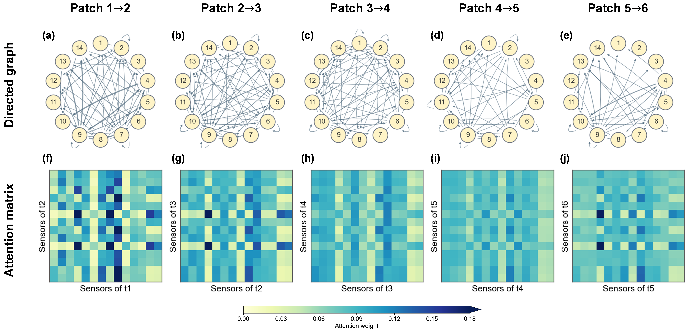

# CSI-Net

## Cross-Spatiotemporal Interaction Network for Remaining Useful Life Prediction

CSI-Net is a graph-based neural network for remaining useful life (RUL) prediction from multivariate equipment-monitoring sequences. It represents each **sensor variable within a temporal patch** as a graph node and propagates information only from one patch to its adjacent future patch. This design jointly captures temporal degradation and cross-variable interactions while preserving the forward direction of time.

<p align="center">
  
</p>

## Motivation

Many RUL models extract temporal dynamics and sensor-variable dependencies in separate processing paths. Such decoupling makes it difficult to represent a dependency that crosses both dimensions, for example:

\[
\text{temperature at } t-1 \;\longrightarrow\; \text{rotational speed at } t.
\]

CSI-Net addresses this limitation by building the two dimensions into one directed patch-level graph.

<p align="center">
  
</p>

## Model overview

For an input window of shape `[batch, time, sensor]`, the released model follows this pipeline:

1. Partition the temporal dimension into consecutive, non-overlapping patches.
2. Project each sensor-variable sequence in a patch into a node embedding.
3. Add sensor-variable and patch-position embeddings.
4. Apply directed graph attention from patch `p-1` to patch `p`.
5. Use residual connections, LayerNorm and a feed-forward network in each encoder layer.
6. Aggregate the final-patch sensor nodes with learned sensor weights and predict a scalar RUL value.

The default configuration follows the experiments in the accompanying manuscript:

| Setting | Value |
| --- | ---: |
| Input window | 30 cycles × 14 sensor variables |
| Patch length | 5 cycles |
| Number of patches | 6 |
| Node dimension | 64 |
| Attention heads | 4 |
| Graph encoder layers | 5 |
| FFN dimension | 256 |
| Dropout | 0.1 |

## Installation

```bash
pip install -r requirements.txt
```

## Minimal usage

The repository intentionally contains the model implementation only. Dataset files, training scripts, evaluation scripts and experiment outputs are not included.

```python
import torch

from csi_net import CSINet

model = CSINet(
    window_size=30,
    in_features=14,
    patch_size=5,
    d_model=64,
    n_heads=4,
    num_layers=2,
    d_ff=256,
    dropout=0.1,
)

x = torch.randn(8, 30, 14)
prediction = model(x)
print(prediction.shape)  # torch.Size([8, 1])
```

To inspect the learned interactions, use `forward_with_attention`:

```python
prediction, graph_attention, post_graph_attention, sensor_weights = \\
    model.forward_with_attention(x)
```

The graph-attention tensors contain the source-to-target weights between adjacent patches. `sensor_weights` contains the learned readout weights of the sensor variables in the final patch.

## Interaction visualization

The directed structure can be inspected through the patch-transition graphs and attention matrices below. Rows represent target sensor variables in the current patch, and columns represent source sensor variables in the preceding patch.

<p align="center">
  
</p>

## Repository scope

This public release contains:

- the CSI-Net model implementation;
- lightweight package exports and dependency information;
- architecture and interaction visualizations;
- the project license.

Training and evaluation scripts, datasets, checkpoints and experiment outputs are intentionally excluded from this repository.

## Citation

If you use CSI-Net in your research, please cite the accompanying paper when its bibliographic information becomes available.

## License

This project is released under the MIT License. See [LICENSE](LICENSE) for details.
