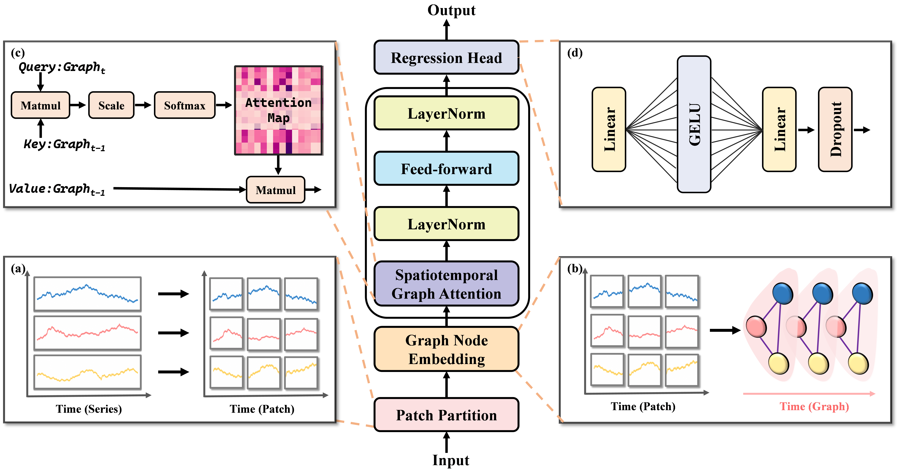
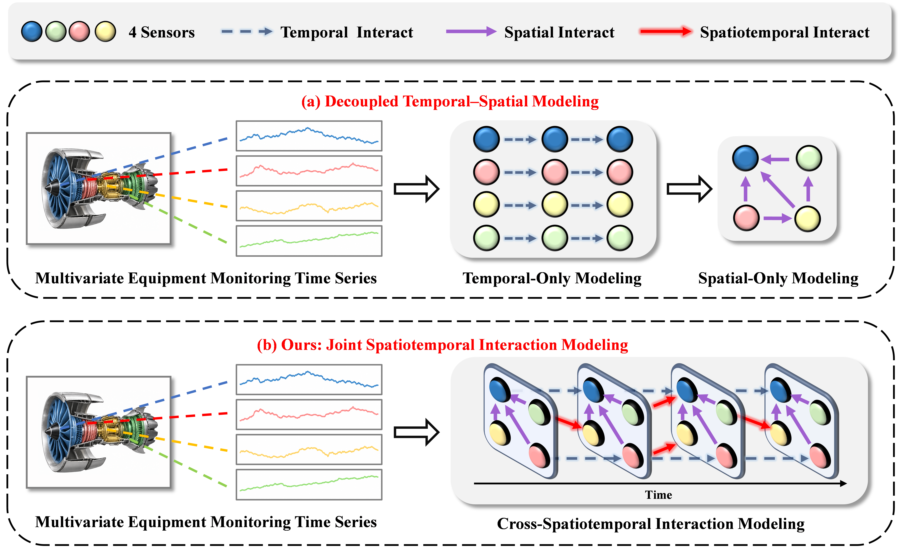

# CSI-Net

## Cross-Spatiotemporal Interaction Network for Remaining Useful Life Prediction

CSI-Net is a graph-based neural network for remaining useful life (RUL) prediction from multivariate equipment-monitoring sequences. It represents each **sensor variable within a temporal patch** as a graph node and propagates information only from one patch to its adjacent future patch. This design jointly captures temporal degradation and cross-variable interactions while preserving the forward direction of time.

  

## Motivation

Many RUL models extract temporal dynamics and sensor-variable dependencies in separate processing paths. Such decoupling makes it difficult to represent a dependency that crosses both dimensions.

CSI-Net addresses this limitation by building the two dimensions into one directed patch-level graph.

  

